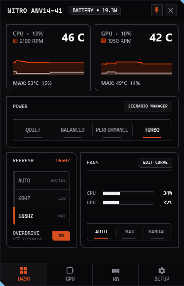
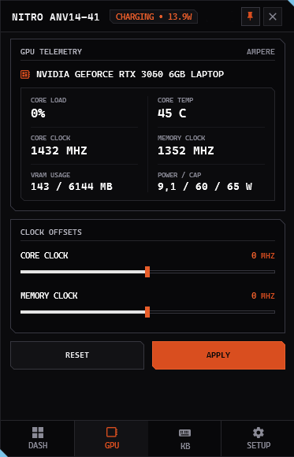
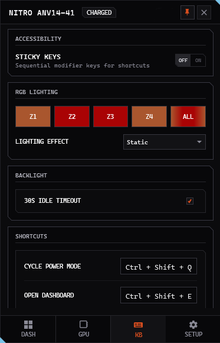
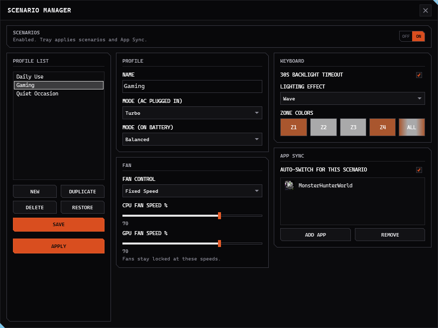

<div align="center">


# Nitrous

**Lightweight hardware control for Acer Nitro and Predator laptops. No bloat, no heavy background services.**

[](https://github.com/AtvouzX/nitrous_fork/releases)
[-0078D6?style=flat-square)](https://github.com/AtvouzX/nitrous_fork)
[](https://dotnet.microsoft.com/download/dotnet/10.0)
[](LICENSE)

<p align="center">
  
  
  
</p>

---

</div>

Nitrous talks directly to your laptop's hardware and replaces the heavy OEM apps. It idles at about 5–15 MB of RAM and stays out of the way in the tray.

### Features

- **Scenario Manager**: Save setups (power mode, fans, keyboard lighting) as named scenarios and switch with one click.

<p align="center">
  
</p>

- **App Sync**: Link an app to a scenario. Nitrous switches when the app opens and switches back when it closes.
- **Power Modes**: Quiet, Balanced, Performance, and Turbo with automatic CPU power limits.
- **Custom Fans**: Per-mode fan curves, fixed speeds, and gentle ramp-down to avoid fan revving.
- **GPU Tuning**: Core and memory clock offsets that respect GPU sleep on battery, so battery life stays intact.
- **Keyboard Lighting**: A color per keyboard zone, lighting effects, and a backlight that turns off after 30 seconds idle.
- **Battery & Display**: 80% charge limit, automatic refresh rate switching, and LCD overdrive on supported models.
- **Acer Service Debloater**: Turn off OEM background services you do not need, and restore them anytime.
- **Hardware Keys**: The Nitro/Predator key opens Nitrous directly.

### Quick Start

Nitrous is portable. No installation needed.

1. Download `Nitrous.exe` from [Releases](https://github.com/AtvouzX/nitrous_fork/releases).
2. Put it in any folder.
3. Run it as Administrator.
4. Optional: turn on **Start with Windows** in Settings.

You need Windows 10 or 11 (64-bit), the [.NET 10 Desktop Runtime](https://dotnet.microsoft.com/download/dotnet/10.0), and an Acer Nitro or Predator laptop from 2021 or newer.

### Compatibility

**Confirmed models:** Acer Nitro 16S `AN16S-61`, Acer Nitro V 15 `ANV15-41`, `ANV15-51`. Predator models should work but are not tested yet.

Check your laptop in PowerShell (as Administrator):

```powershell
Get-CimInstance -Namespace root\WMI -ClassName AcerGamingFunction
```

Tested on a different model? Please [open an issue](https://github.com/AtvouzX/nitrous_fork/issues) and help grow this list.

---

*Disclaimer: Unofficial open-source utility. Not affiliated with Acer Inc. Use at your own risk.*
