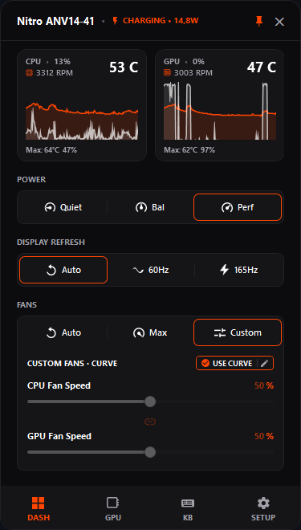
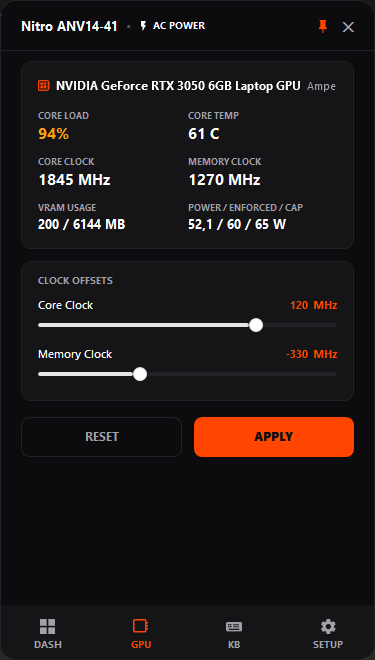
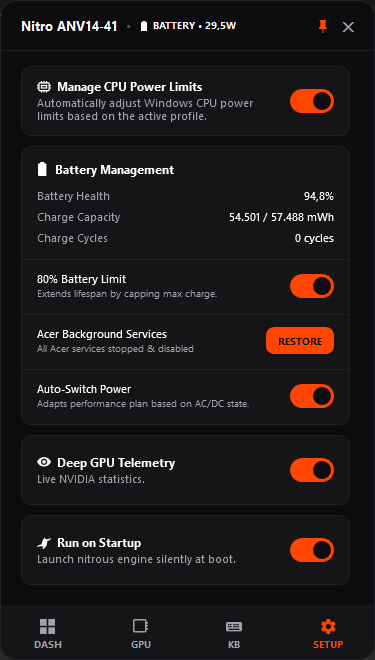

<div align="center">


# Nitrous

**Lightweight, zero-bloat hardware control utility for Acer Nitro and Predator laptops.**

[](https://github.com/AtvouzX/nitrous_fork/releases)
[-0078D6?style=flat-square)](https://github.com/AtvouzX/nitrous_fork)
[](https://dotnet.microsoft.com/download/dotnet/10.0)
[](LICENSE)

<p align="center">
  
  
  
</p>

---

</div>

Nitrous interacts directly with your laptop's Embedded Controller (EC) via Windows Management Instrumentation (`root\WMI` -> `AcerGamingFunction`), replacing heavy OEM background services with a fast dashboard and an ~8–15 MB idle footprint.

### Features

- **Custom Fan Curves**: Waypoint editor per power profile.
- **Power Modes & Boost Control**: Fast EC switching (Quiet, Balanced, Performance, Turbo) with automatic CPU power limit mitigation.
- **GPU Tuning & Sleep Preservation**: Core and memory clock offsets with auto-apply on wake while keeping discrete graphics asleep on battery.
- **Acer Service Debloater**: One-click disable and restore for background OEM services.
- **Hardware Key Support**: Redirects NitroSense and PredatorSense keys directly to Nitrous.
- **Battery & Display Automation**: Hardware 80% charge limit and automatic 60Hz/max refresh rate switching.
- **On-Screen Display (OSD)**: Visual HUD notifications when switching profiles.

### Prerequisites

- **Operating System**: Windows 10 or Windows 11 (64-bit).
- **Runtime**: [.NET 10.0 Desktop Runtime](https://dotnet.microsoft.com/download/dotnet/10.0) (x64).
- **Permissions**: Administrator privileges.
- **Hardware**: Acer Nitro or Predator laptop with `AcerGamingFunction` WMI support.

### Quick Start

Nitrous is portable and requires no installation.

1. Download `Nitrous.exe` from [Releases](https://github.com/AtvouzX/nitrous_fork/releases).
2. Place the executable in any folder (e.g., `C:\Tools\Nitrous`).
3. Run `Nitrous.exe` as Administrator.
4. *(Optional)* Enable **Start with Windows** in Settings for silent, UAC-free startup.

### Compatibility

Designed for modern Acer Nitro and Predator laptops (2021+) supporting the `AcerGamingFunction` WMI interface.

*Note: Predator models are not yet tested. While the underlying WMI calls, service management, and launcher hooks are designed to support both Nitro and Predator architectures, verified testing on Predator hardware is still needed.*

**Confirmed Models:**
- **Acer Nitro 16S**: `AN16S-61`
- **Acer Nitro V 15**: `ANV15-41`, `ANV15-51`

**Check Compatibility:** Run this command in PowerShell as Administrator to verify support:
```powershell
Get-CimInstance -Namespace root\WMI -ClassName AcerGamingFunction
```

Tested on a different model? Please [open an issue](https://github.com/AtvouzX/nitrous_fork/issues) to report your results and help expand the confirmed list.

---

*Disclaimer: Unofficial open-source utility. Not affiliated with Acer Inc. Use at your own risk.*
